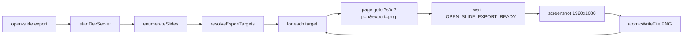
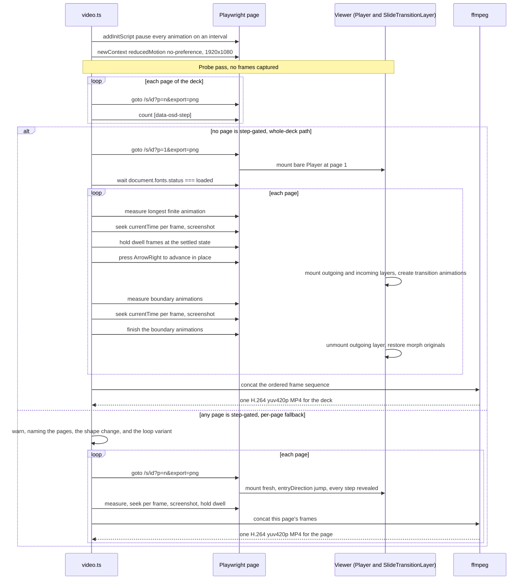
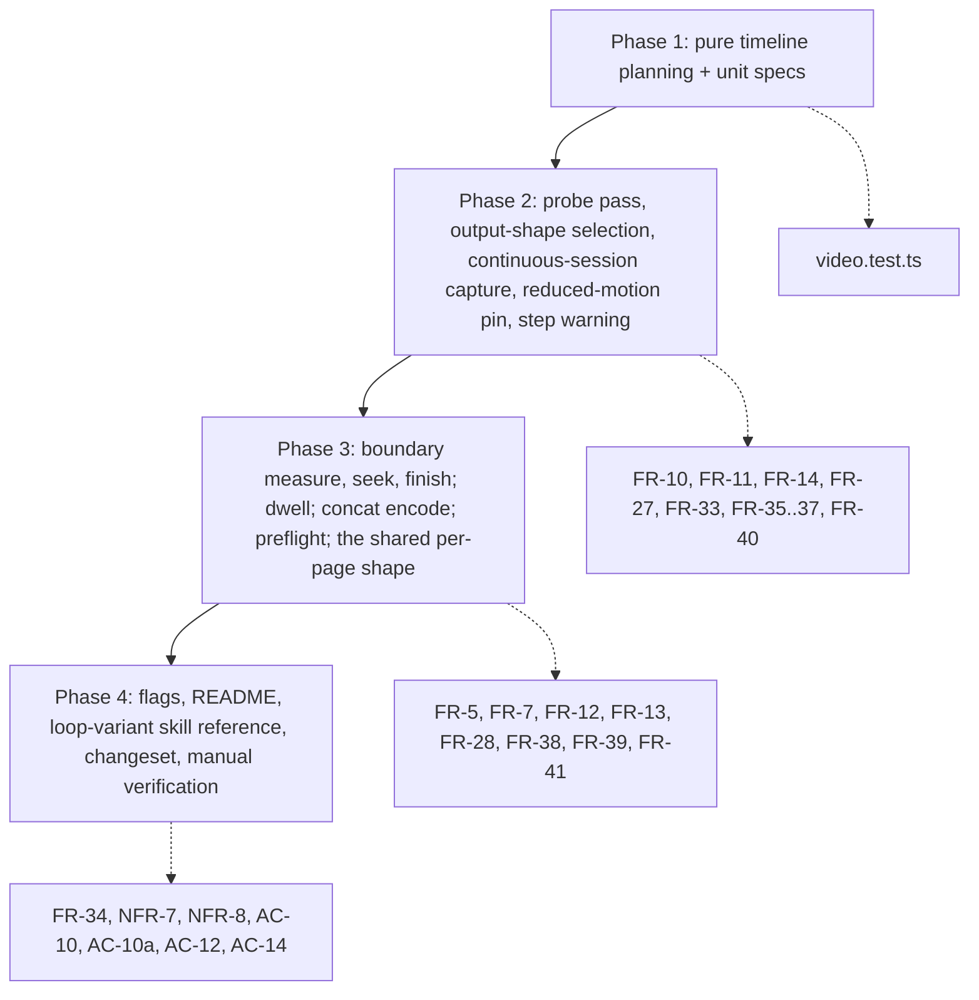

# Capture a whole deck as video from the CLI

## Change Summary

CR-0002 added `open-slide export`, which drives headless Chromium and writes one
settled PNG per page. That establishes the capture pipeline — in-process Vite
boot, Playwright launch, deck enumeration, target resolution, atomic writes — but
it captures still frames only, and it captures them *after* animation has
finished.

This change adds `open-slide video`, which reuses that pipeline to produce a
**single continuous MP4 of an entire deck**: every page's animation played
through at a fixed frame rate, held for a configurable dwell, joined by the
viewer's own slide transitions, and encoded once. A prototype on this branch has proven
the load-bearing mechanism — pausing every animation as it appears and driving
`Animation.currentTime` explicitly — and captures one page correctly. This
Change Request covers the work of turning that into a whole-deck feature.

One deck does not get the single-file treatment: a deck whose pages are gated by
`<Steps>` cannot be crossed by a continuous session without walking its reveals,
so it falls back to one MP4 per page and the command says so. That is the only
place the output shape is decided by the deck rather than by the user, and it is
covered in full under Proposed Change.

## Motivation and Background

A deck is currently shareable three ways: presented live, exported as static
HTML, or exported as PDF. All three require a viewer to drive the deck
themselves, and none of them carry the animation an author spent effort on.

**A recording is the missing distribution format.** Release notes, README
headers, docs pages, and social posts all take video and none of them take a
deck. Authors who want this today screen-record present mode, which is the wrong
tool: a screen capture samples whenever the compositor delivered a frame, so it
drops and duplicates frames under load, cannot be reproduced, and bakes in
whatever the recording machine was doing at the time. The result is also
unreviewable — a re-record is never the same file, so it cannot be diffed or
regenerated in CI. A seeked capture is reproducible to the bound FR-24 states:
page segments and dwell holds come back byte identical, and boundary segments
come back within a documented perceptual bound rather than bit for bit.

**The pipeline to do it properly already exists.** `export.ts` boots Vite in
process, launches Chromium, enumerates decks, resolves targets, and writes
atomically. None of that needs rebuilding. What it lacks is time: `renderOne`
navigates, waits for the page to settle, and screenshots once.

**The one genuinely hard part is already solved.** Decks animate with wall-clock
CSS keyframes and expose no playhead, so frames cannot be sampled on a timer. The
prototype pauses every animation as it appears and sets `currentTime` per frame,
which makes existing CSS-keyframe decks seekable with **no authoring change**.
Verified on the `vercel-ai-sdk` deck: 5 animations detected, 1500ms measured, 36
of 36 captured frames unique.

That prototype also surfaced the defining constraint of this work, which is worth
stating plainly because it is counter-intuitive: **the existing readiness signal
must not be used for video capture.** `__OPEN_SLIDE_EXPORT_READY` means every
finite animation has finished, and a finished animation leaves
`document.getAnimations()` — so seeking after readiness finds nothing to seek and
produces the settled frame repeated N times. The PNG exporter is built to wait
for motion to stop; video requires that it never start.

## Change Drivers

* No path from a deck to a shareable video except screen recording
* Screen recordings are non-reproducible, drop frames, and cannot be regenerated in CI; a seeked capture is reproducible to the bound FR-24 states
* Authored animation is invisible in every current export format
* The headless capture pipeline from CR-0002 is already in place and reusable
* The seeking mechanism is proven on this branch and needs no authoring change

## Current State

`open-slide export` (CR-0002) captures stills:

- `exportCommand` validates flags, preflights `playwright-chromium`, boots Vite
  via `startDevServer`, enumerates decks with `enumerateSlides`, and resolves
  `(slideId, pageIndex, total)` tuples with `resolveExportTargets`.
- `renderOne` navigates to `/s/{slideId}?p={n}&export=png`, waits for
  `window.__OPEN_SLIDE_EXPORT_READY`, screenshots a 1920×1080 clip, and writes it
  atomically.
- Readiness is defined in `print-ready.ts` as fonts loaded, `data-waitfor`
  targets present, and every finite animation reaching `finished`.

A prototype `open-slide video` exists on this branch. It captures **one page per
MP4**, measures duration from the longest finite animation, seeks with
`Animation.currentTime`, and encodes with ffmpeg. It is not a whole-deck feature:
there is no page sequencing, no dwell, no transitions, no single output file, no
tests, and no ffmpeg preflight.

### Current State Diagram



Every target is an independent page load, and every capture happens after motion
has stopped. Both properties are exactly what the video path has to invert.

## Proposed Change

Promote the prototype into a deck-level capture command.

**One deck, one file — unless the deck is step-gated.** `open-slide video
--slide <id>` produces a single MP4 covering every page in order, and `--all`
produces one file per deck. Per-page output remains available behind a flag for
authors who want the pieces, and is also what a step-gated deck falls back to
automatically; see below. There are therefore two output shapes behind one
command, and which one a deck gets is decided by the deck, not by the user, so
the command has to say which it produced.

**A page's timeline is animation, then dwell.** Each page contributes its
measured animation duration followed by a configurable hold, so a reader has time
to absorb the settled state before the deck advances. Pages with no finite
animation contribute dwell alone.

**Pages are joined by the viewer's own transition.** Rather than composing a
crossfade at encode time, the capture advances the deck inside the viewer and
seeks the transition animations that `slide-transition-layer.tsx` creates,
exactly as it does for a live audience. The viewer already resolves per-module
`SlideTransition` definitions — phases, easing, and morph — and a second
encode-time definition of "transition" would drift from it. This means the
capture is one continuous browsing session that advances page to page, not a
sequence of independent page loads, and ffmpeg concatenates a single ordered
frame sequence with no filter graph.

**The advance goes through the viewer, and the boundary is measured, not
declared.** `?export=png` already renders the bare `Player`, and `Player`'s
arrow-key handler is not gated on its `controls` prop, so the capture can drive
the same navigation an audience does without touching the viewer. Two
consequences fall out of the viewer's actual implementation. First, the length
of a boundary cannot be read off `SlideTransition.duration`: each phase may
override `duration` and `delay`, and a `morph` phase carries its own, so the
boundary is measured from the animations that actually appeared, exactly as a
page is. Second, the transition animations have to be allowed to finish once
their last frame is captured — the layer only unmounts the outgoing page and
restores morph-hidden originals when every transition animation resolves, so a
boundary left paused would strand the outgoing layer over every page after it.

**Capture holds animations from the start.** Every animation is paused as it
appears via an init script, and `currentTime` is set explicitly per frame. This
applies equally to page-content animations and to the transition animations the
viewer creates on advance. Fonts are awaited directly rather than through the
export readiness flag, which can no longer fire. The browser context also pins
`prefers-reduced-motion: no-preference`, because the viewer disables transitions
outright under a `reduce` preference and would otherwise capture a deck with no
boundaries at all.

**Step-gated decks fall back to per-page files, and are told so.** The obstacle a
step-gated deck presents is not the page, it is the *advance*: `Player.goNext`
reveals the next pending step and only moves to the next page once none remain,
so a continuous session cannot cross a step-gated page without walking its
reveals and baking them into the frames. Rather than walk them, and rather than
add a step-bypassing path to the viewer, such a deck is captured page by page —
one MP4 per page, each page loaded fresh.

Loading fresh is what makes this an acceptable outcome rather than a degraded
one. A page mounted directly arrives with `entryDirection` at `jump`, and
`Steps` initialises to `stepCount` for any direction other than `forward`, so
every step is already revealed. The slide-authoring skill states the same rule
from the author's side: jumping in shows all steps revealed. **No content is
lost.** What is lost is the reveal *motion* — `Step`'s opacity transition only
fires when `_revealed` changes, which never happens on a fresh mount — and the
inter-page transitions, because per-page files have no boundaries.

The command detects step-gating by counting the `[data-osd-step]` elements the
viewer already renders — no new automation hook — and warns. The warning has to
carry the shape change, because the user asked for one file per deck and is
getting N; discovering that by listing the output directory is not acceptable.
It then recommends the concrete route back to a single-file deck video: author a
**loop variant** of the deck — a sibling deck built for capture rather than for
presenting, in which the step reveals are replaced by time-based animations,
pages carry transitions, pages advance automatically instead of on input, and the
last page transitions back into the first page's background so the resulting file
plays as a seamless loop. A deck authored that way needs no presenter, which is
precisely what a recording lacks. Those four elements are also documented as an
authoring pattern in the slide-authoring skill, and the two statements of them
are single sourced so they cannot drift apart.

**ffmpeg is preflighted like Playwright.** The command checks for ffmpeg before
doing any work and exits with a copy-pasteable install message, matching the
treatment `playwright-chromium` already receives.

### Proposed State Diagram



On the whole-deck path the loop never reloads the document: one navigation, one
continuous session, and the boundary segments are the viewer's own animations
sampled at the same offsets an audience would see them. The fallback path is
deliberately the older shape, one independent load per page, which is exactly why
it has no boundaries to capture and exactly why it needs no step-bypassing
navigation. Both branches converge on one capture and encode implementation per
FR-39; the `alt` shows two output shapes, not two code paths.

## Requirements

### Functional Requirements

1. The CLI **MUST** provide a `video` subcommand that renders deck pages to MP4 via headless Chromium.
2. The subcommand **MUST** accept `--slide <id>` to capture a single deck and `--all` to capture every discoverable deck, and these **MUST** be mutually exclusive.
3. The subcommand **MUST** accept `--page <n>` to capture a single 1-based page, and `--page` **MUST** require `--slide`.
4. A capture of a deck **MUST** by default produce exactly one MP4 file containing every selected page in page order, except where FR-38 requires the per-page fallback.
5. The subcommand **MUST** accept `--per-page`, which instead writes one MP4 per captured page, named by the same `{slideId}-p{NN}.mp4` convention the prototype already uses.
6. The subcommand **MUST** accept `--fps <n>` and **MUST** reject values outside 1 to 120 inclusive.
7. The subcommand **MUST** accept `--dwell <ms>`, a single dwell duration that applies to every page in the run and is held after that page's animation completes, defaulting to `1500`. Per-page dwell is out of scope.
8. Inter-page transitions **MUST** be captured from the viewer by advancing the deck in place and seeking the transition animations the viewer creates, and **MUST NOT** be synthesised at encode time. FR-8 through FR-13 govern the whole-deck path only; per-page output, whether requested by `--per-page` or required by FR-38, has no page boundaries and therefore no transition segments.
9. The capture **MUST** honour whatever transition the viewer resolves for the incoming page — `pages[index].transition` when present, otherwise the module-level `transition`, and no transition when neither is declared — so the output matches what the viewer renders for a live audience.
10. The subcommand **MUST** capture a deck as one continuous browsing session that advances page to page, rather than loading each page independently, so that transition animations exist to be seeked.
11. The advance between pages **MUST** be driven through the viewer's own navigation path, so that `SlideTransitionLayer` mounts the outgoing and incoming layers and creates the transition animations. The capture **MUST NOT** advance by navigating the browser to a new `?p=` URL, because a reload destroys the outgoing layer and with it every transition animation.
12. The duration of a transition segment **MUST** be measured from the animations the viewer actually created at that boundary, using the same longest-finite-animation measurement applied to pages. It **MUST NOT** be read from the declared `SlideTransition.duration`, because per-phase `duration`/`delay` overrides and a `morph` phase's own `duration`/`delay` can each extend the real boundary timeline beyond that value.
13. After the final frame of a transition segment is captured, the capture **MUST** drive those transition animations to a finished state before capturing the next page's segment, because `SlideTransitionLayer` unmounts the outgoing layer and restores morph-hidden originals only once every transition animation resolves. Leaving them paused strands the outgoing layer and the morph overlay on screen for every subsequent page.
14. The browser context **MUST** emulate `prefers-reduced-motion: no-preference`, because `Player` passes `disabled={prefersReducedMotion}` to `SlideTransitionLayer`, and a `reduce` preference makes the viewer swap pages with no animation at all — producing a silently transition-free capture.
15. Each page's animation duration **MUST** be measured from the longest finite animation on that page.
16. A page whose animations are all infinite, or which has no animations, **MUST** contribute its dwell duration rather than being skipped.
17. Infinite animations **MUST** be seeked along with finite ones, so looping motion animates in the output.
18. A measured page or transition duration **MUST** be clamped to a documented upper bound of `60000` ms, so a single runaway delay cannot produce an unbounded render.
19. The subcommand **MUST** accept `--duration <ms>`, which replaces the measured duration for every page.
20. Every animation on a page **MUST** be paused before it can play out, and **MUST NOT** reach a finished state during capture, with the single exception of the deliberate transition finish required by FR-13.
21. The capture **MUST NOT** gate on `window.__OPEN_SLIDE_EXPORT_READY`, because that signal requires the animations it needs to seek to have already finished and left `document.getAnimations()`.
22. The capture **MUST** wait for fonts to load before capturing any frame.
23. Frames **MUST** be captured at exactly `1920 × 1080`, matching the fixed canvas the rest of the toolchain uses.
24. Frame capture **MUST** be deterministic, to a bound that differs by segment kind. Across two runs over an unchanged deck: every frame of a page segment and of a dwell hold **MUST** be byte-identical, and every frame of a transition boundary segment **MUST** be perceptually identical to the documented bound — per corresponding frame pair, `YMAX <= 160` **and** `YAVG <= 1.0` on the absolute luma difference. Byte-identity **MUST NOT** be required of boundary frames: edge antialiasing on scale-animated compositor layers rasterises to one of two stable variants, chosen per run, so a boundary frame can differ between runs without any capture defect. The frame index and count of every segment **MUST** be identical across runs regardless of kind.
25. The subcommand **MUST** preflight `playwright-chromium` and exit with an actionable install message when it is absent, matching the export subcommand.
26. The subcommand **MUST** preflight `ffmpeg` and exit with an actionable install message when it is absent from `PATH`.
27. Under `--all`, a deck reporting zero pages **MUST** be named on stderr and skipped rather than encoded, reusing `zeroPageDeckIds` from the export module, because an empty frame sequence makes ffmpeg fail the whole run.
28. The encoder **MUST** produce H.264 in `yuv420p` with even dimensions, so output plays in browsers and system players rather than only in developer tooling.
29. Intermediate frames **MUST** be removed after a successful encode unless `--keep-frames` is passed.
30. The subcommand **MUST** tear down the browser and the Vite dev server on every exit path, including error and usage-error paths.
31. Usage errors and failed prerequisite preflights **MUST** exit with code 2, and runtime errors **MUST** exit with code 1, matching the export subcommand.
32. `playwright-chromium` **MUST** remain a `devDependency` and **MUST NOT** be reachable from the published runtime bundle except through a dynamic import.
33. The subcommand **MUST** report, per page, the number of animations detected, the resolved duration, and the frame count.
34. The subcommand **MUST** print `--help` examples covering every flag it accepts.
35. The subcommand **MUST** detect step-gated pages and **MUST** name them. The step count **MUST** be read from the DOM the viewer already renders — the number of `[data-osd-step]` elements within the active page layer — and **MUST NOT** require a new `window` automation hook.
36. The step-gated warning **MUST** state, in this order: which pages are step-gated; that the deck was written as one MP4 per page rather than one per deck, and why; that each such page is captured with every step already revealed, so no content is missing, but that the reveal beats and the inter-page transitions are not in the output; and that authoring a loop variant is the route back to a single-file deck video. It **MUST** state what a loop variant entails: step reveals replaced by time-based animations, transitions declared between pages, automatic page advance, and a closing transition into the first page's background so the file plays as a seamless loop.
37. The step-gated warning **MUST NOT** fail the run or change the exit code, because the per-page fallback is a successful outcome rather than a degraded one.
38. A deck containing at least one step-gated page **MUST** be written as one MP4 per page rather than one MP4 for the deck, without the user passing `--per-page`. The capture **MUST NOT** advance past a pending step in order to reach the next page, and **MUST NOT** require any change to the viewer to avoid doing so.
39. The automatic fallback required by FR-38 and the explicit `--per-page` flag **MUST** resolve to the same capture path, the same encode path, and the same filename derivation. There **MUST NOT** be a second per-page implementation, and a file produced by the fallback **MUST** be indistinguishable from one produced by the flag.
40. Whether a deck is step-gated **MUST** be determined for every page of that deck before any frame of it is captured, because the output shape is a per-deck decision that cannot be revised once a continuous session has begun. The probe **MAY** load pages independently, since it captures no frames and no transitions.
41. Under `--all`, a run mixing step-gated and non-step-gated decks **MUST** produce both output shapes in one invocation, and the closing summary **MUST** state, per deck, which shape it produced.

### Non-Functional Requirements

1. The subcommand **MUST** reuse the dev-server boot, deck enumeration, target resolution, and atomic write helpers from the export module rather than reimplementing them.
2. Readiness predicates and timing constants **MUST** continue to live in one place, so the video path does not fork a second definition of what "ready" means.
3. Transition behaviour **MUST** remain single sourced in the viewer's transition module. The video path **MUST NOT** define its own transition vocabulary, durations, or easing.
4. Pure helpers — duration resolution, frame counting, filename derivation, timeline planning — **MUST** be exported separately from the orchestration so they are unit-testable without Playwright or ffmpeg. Because page and transition durations are only knowable in the browser (FR-12, FR-15), the planner **MUST** take already-measured durations as inputs and **MUST NOT** measure anything itself.
5. `pnpm check` and `pnpm typecheck` **MUST** pass with no diagnostics on the resulting tree.
6. The subcommand **MUST NOT** require any change to how existing decks author their animations.
7. The change **MUST** include a `.changeset/` entry against `@open-slide/core` with a `minor` bump, per the repository's hard rule that any `packages/core` change carries a changeset.
8. The four elements of a loop variant **MUST** be single sourced. They **MUST** be declared once in `video.ts` as an exported constant, the CLI warning **MUST** compose its text from that constant, and a unit spec **MUST** assert that the loop-variant reference file in the slide-authoring skill states the same four elements. Two independently maintained prose copies are not acceptable, because the warning's whole value is that it tells the author what the skill will then help them build.

## Affected Components

Modified or added:

* `packages/core/src/cli/video.ts` — the subcommand: timeline planning, capture, encode, orchestration
* `packages/core/src/cli/video.test.ts` (new) — unit specs for the pure helpers
* `packages/core/src/cli/run.ts` — Commander registration, flag parsing, help text; adds `--dwell` and `--per-page` to the flags already registered on this branch
* `.changeset/<slug>.md` (new) — `minor` bump for `@open-slide/core`, per NFR-7
* `README.md` — the CLI reference lives here (the "Export to static HTML, PDF & PNG" section already documents `open-slide export`)
* `apps/web/content/docs/cli/video.mdx` (new) and `apps/web/content/docs/cli/meta.json` — the docs site carries a page per subcommand (`build`, `dev`, `export`, `init`, `overview`, `preview`, `sync-skills`), added by CR-0002's doc-update commit `7326fdf`. `video` follows the same shape as the `export` page
* `packages/core/skills/slide-authoring/references/loop-variant.md` (new) — the loop variant as an authoring pattern, following the one-file-per-primitive convention already used by `steps.md` and `transitions.md`. This is the real path: the entries under `apps/demo/.claude/skills/` are symlinks that resolve here, and `open-slide sync:skills` distributes this directory to user workspaces
* `packages/core/skills/slide-authoring/SKILL.md` — one row added to the "Primitive references" table pointing at `references/loop-variant.md`, and a short summary section matching the file's existing per-primitive structure

Consumed as-is, no behavioural change:

* `packages/core/src/cli/export.ts` — already exports `startDevServer`, `enumerateSlides`, `resolveExportTargets`, `zeroPageDeckIds`, `atomicWriteFile`, `tryImportPlaywright`, and `ExportUsageError`
* `packages/core/src/app/lib/transition.ts`, `packages/core/src/app/components/slide-transition-layer.tsx` — the transitions they produce are seeked rather than reimplemented; `resolveTransition` decides which transition applies, and the layer's `Promise.all(anims.map(a => a.finished))` completion handler is why FR-13 exists
* `packages/core/src/app/components/player.tsx` — supplies the in-place navigation the capture drives; note that its arrow-key handler is not gated on `controls`, so it is reachable in `?export=png` mode, and that it passes `disabled={prefersReducedMotion}` to the transition layer, which is why FR-14 exists
* `packages/core/src/app/routes/slide.tsx` — `?export=png` already renders the bare `Player`, so the capture route needs no change
* `packages/core/src/app/lib/step-context.tsx` — `Step` already renders `data-osd-step="revealed" | "pending"` unconditionally, so the step count FR-35 needs is readable from the DOM with no viewer change

## Scope Boundaries

### In Scope

* The `video` subcommand and its flags
* Whole-deck capture into a single file, with per-page output behind a flag and as the automatic fallback for step-gated decks
* A run-wide dwell, and capture of the viewer's own inter-page transitions
* Animation seeking, font readiness, and deterministic frame capture — byte identical for page segments and dwell holds, perceptually bounded for transition boundary segments per FR-24
* Detecting step-gated pages, falling back to per-page output for them, and warning with the loop-variant recommendation
* ffmpeg preflight and H.264 encode settings
* Unit specs for the pure helpers
* A changeset and a `minor` bump on `@open-slide/core`
* A CLI reference entry in `README.md`
* A loop-variant authoring pattern in the slide-authoring skill, single sourced with the CLI warning text

### Out of Scope ("Here, But Not Further")

* **Audio.** No narration, music, or timing to an audio track.
* **Presenter-driven timing.** Dwell is a flag, not a recording of how long a presenter actually spent on a page.
* **Per-page dwell.** One dwell applies to the whole run. No deck-level config, no `data-` attribute override.
* **Sequencing through steps.** The capture never advances past a pending step. A step-gated deck is captured page by page, each page loaded fresh and therefore fully revealed; the reveal beats themselves are not animated in the output. Driving steps as a timeline is a separate change.
* **A step-bypassing navigation path in the viewer.** Considered and rejected in favour of the per-page fallback, precisely so this stays a capture-only change. `player.tsx` is consumed as-is.
* **Generating the loop variant.** The command recommends authoring one, says what it entails, and the skill documents the pattern. Neither scaffolds, rewrites, nor derives a deck.
* **New transition types.** The capture takes the viewer's transitions as they are; adding transitions is a viewer change, not a capture change.
* **Formats other than MP4.** No WebM, GIF, or image-sequence-only output.
* **An in-browser recording UI.** This is CLI and CI tooling, matching the export subcommand's positioning.
* **Changing the PNG exporter.** `export.ts` is consumed as-is.
* **Bundling ffmpeg.** It is preflighted and reported, never vendored.

## Alternative Approaches Considered

* **Screen-record present mode.** Rejected: non-reproducible, drops frames under load, cannot run in CI, and bakes in the recording machine's state.
* **CDP `Emulation.setVirtualTimePolicy`.** Rejected: coarser than the Web Animations API and unreliable for compositor-driven `transform` and `opacity`, which is what slide animations overwhelmingly use.
* **Require decks to expose a playhead.** Rejected: it would make every existing CSS-keyframe deck uncapturable and push a rendering concern into authoring.
* **Compose transitions at encode time.** Rejected: it costs no browser time and makes the transition adjustable without a re-capture, but it defines "transition" a second time, alongside the viewer's existing transition module. The two would drift, and a captured deck would stop looking like the deck. Capturing the viewer's own transition is the version that stays true to the deck.
* **Reuse only the viewer's transition names and timings, executed at encode time.** Rejected: it removes the divergent vocabulary but not the divergent rendering, and morph transitions cannot be reproduced by a filter graph at all.
* **Capture transitions in the browser.** **Chosen.** This entry was listed as rejected in the CR's first draft, on the grounds that it costs browser time and turns capture into a continuous session. The maintainers reversed that: the cost is real but bounded, and it is the only option that keeps one definition of "transition" in the repository.
* **Screenshot on a timer without pausing.** Rejected: this is the failure mode the whole design exists to avoid.

## Impact Assessment

### User Impact

Purely additive. Authors gain a video output; nobody's existing workflow changes,
and no deck needs editing to be capturable. The cost is two external
prerequisites, both preflighted with actionable messages.

### Technical Impact

No change to the published runtime bundle: Playwright stays a `devDependency`
behind a dynamic import, and ffmpeg is invoked as a subprocess. The new module
consumes the export module's helpers, so the readiness definition stays single
sourced, and it consumes the viewer's transition module rather than restating
it, so transition behaviour stays single sourced too. Render time scales with
total frame count, which is bounded by the per-page duration clamp; capturing
transitions rather than composing them adds browser time proportional to the
number of page boundaries, and confines the output's byte-level determinism to
page segments and dwell holds: boundary segments carry a compositor
rasterisation variance and are held to the perceptual bound in FR-24 instead.
See Risk 12.

The one structural departure from the export path is that whole-deck capture is a
single continuous browsing session rather than a series of independent page
loads, which is what makes the viewer's transition animations exist to be seeked.
A step-gated deck keeps the export path's shape instead — one independent load
per page — which is precisely why it needs no step-bypassing navigation and
therefore no viewer change.

### Business Impact

Removes the main friction in sharing a deck with people who will not open it.
Recordings become a build artifact that can be regenerated on every change rather
than a manual re-record.

## Implementation Approach

Four phases. Each leaves the repository with `pnpm typecheck`, `pnpm check`, and
`pnpm test` passing.

### Phase 1 — Timeline planning

Extract page timeline planning into pure, exported functions: measured duration
resolution, dwell application, frame counting, and the deck-level plan that maps
`(segment, frameIndex)` to a seek time on either a page segment or a transition
segment. Per NFR-4 the planner takes measured durations as inputs and measures
nothing itself, because both page durations (FR-15) and transition durations
(FR-12) are only knowable in the browser. Cover with unit specs. No browser
involved.

### Phase 2 — Probe pass, output-shape selection, and whole-deck capture

Add the probe pass that visits every page of a deck and counts `[data-osd-step]`
before any frame is captured, and derive the deck's output shape from it (FR-35,
FR-40). Emit the step-gated warning required by FR-36 and FR-37, composed from
the single-source loop-variant constant (NFR-8).

Then capture a non-step-gated deck into one ordered frame sequence rather than a
per-page directory, as a single browsing session that advances page to page
through the viewer's own navigation (FR-10, FR-11). Create the browser context
with `reducedMotion: 'no-preference'` (FR-14). Hold animations from the start via
an init script, wait on fonts directly, and seek per frame. Skip and report
zero-page decks via `zeroPageDeckIds` (FR-27). Emit the per-page report line
required by FR-33.

### Phase 3 — Transition capture, dwell, encode, and the per-page shape

Seek the viewer's transition animations at each page boundary as a segment of
the same frame sequence, so the transition is captured rather than synthesised.
Measure each boundary from the animations that actually appeared (FR-12) and
finish them once their last frame is captured, so the layer unmounts the outgoing
page before the next segment begins (FR-13). Apply the run-wide `--dwell`.
Concatenate the sequence into one MP4 — no filter graph. Add the ffmpeg preflight
and the H.264 settings required by FR-28.

Add the per-page output shape once, reached both by `--per-page` and by the
FR-38 fallback, sharing one capture path, one encode path, and one filename
derivation (FR-39). Report the per-deck shape in the closing summary so a mixed
`--all` run is legible (FR-41).

### Phase 4 — Registration, docs, changeset, and verification

Register `--dwell` and `--per-page` alongside the Commander flags already on this
branch, and extend the `--help` examples to cover every flag, including a note
that step-gated decks fall back to per-page output. Add the CLI reference entry
to `README.md`. Write `references/loop-variant.md` in the slide-authoring skill
and link it from the "Primitive references" table in `SKILL.md`, keeping its four
elements identical to the CLI constant and covering that with the NFR-8 spec. Run
`pnpm changeset` and write a single-line `minor` entry for `@open-slide/core`.
Carry out the manual verification table below: determinism by capturing the same
deck at least three times and comparing the frame sequences per file — byte
identity for page segments and dwell holds, the AC-10a perceptual bound for
transition boundary segments — stream properties via `ffprobe`, and
confirmation that the published bundle contains no static Playwright reference.

### Implementation Flow



## Test Strategy

### Tests to Add

| Test File | Test Name | Description | Inputs | Expected Output |
|-----------|-----------|-------------|--------|-----------------|
| `video.test.ts` | `resolveDurationMs uses the measured value` | Measured duration is used when no override is given | `longestMs = 1800` | `1800` |
| `video.test.ts` | `resolveDurationMs falls back when nothing is measurable` | Pages with no finite animation get the fallback | `longestMs = 0` | fallback constant |
| `video.test.ts` | `resolveDurationMs clamps a runaway duration` | An absurd measurement is bounded | `longestMs = 10_000_000` | upper bound |
| `video.test.ts` | `resolveDurationMs honours the override` | An explicit duration replaces the measurement | override supplied | override, clamped |
| `video.test.ts` | `frameCountFor never returns zero` | A still page still contributes a frame | `durationMs = 0` | `1` |
| `video.test.ts` | `frameCountFor scales with fps` | Frame count follows the rate | `1000ms` at 24 and 60 | `24`, `60` |
| `video.test.ts` | `planDeckTimeline orders pages and applies dwell` | Deck plan is page-ordered with dwell appended | two measured page durations, dwell set | expected segment list |
| `video.test.ts` | `planDeckTimeline applies one dwell to every page` | Dwell is run-wide, not per page | three measured page durations, dwell set | identical dwell on each segment |
| `video.test.ts` | `planDeckTimeline emits a transition segment from a measured boundary` | Boundaries become their own seekable segments, sized by what was measured | two page durations plus one measured boundary duration | page, transition, page |
| `video.test.ts` | `planDeckTimeline emits no transition segment for a single page` | Nothing to transition to | one page duration | one segment |
| `video.test.ts` | `planDeckTimeline emits no transition segment for a zero-length boundary` | A deck that declares no transition measures zero animations at the boundary | two page durations, boundary duration `0` | two segments, no boundary |
| `video.test.ts` | `stepGatedPages flags pages with a non-zero step count` | Warning targets the right pages | mixed step counts | only gated page indices |
| `video.test.ts` | `stepGatedWarning names the pages, the shape change, and the loop variant` | Warning explains why the output shape changed, not just that steps exist | two gated pages of five | message naming the pages, the per-page shape and its reason, the fully-revealed capture, and the four loop-variant elements |
| `video.test.ts` | `outputShapeFor picks per-page when any page is step-gated` | The fallback is per deck, not per page | one gated page of four | per-page shape |
| `video.test.ts` | `outputShapeFor picks whole-deck when no page is step-gated` | The fallback does not fire otherwise | zero step counts | whole-deck shape |
| `video.test.ts` | `outputShapeFor picks per-page when --per-page is passed` | Flag and fallback resolve to one shape value | no gated page, flag set | per-page shape |
| `video.test.ts` | `frameFilenameFor sorts lexically` | Zero padding keeps ffmpeg's glob in temporal order | indices 9, 10, 100 | correctly padded |
| `video.test.ts` | `videoFilenameFor derives a deck-level name` | Whole-deck capture names by deck, not page | deck id | `{slideId}.mp4` |
| `video.test.ts` | `videoFilenameFor derives a page-level name for the per-page shape` | One derivation serves both the flag and the fallback | deck id, page index, total | `{slideId}-p{NN}.mp4`, identical for flag and fallback inputs |
| `video.test.ts` | `LOOP_VARIANT_ELEMENTS matches the slide-authoring reference` | The warning and the skill cannot drift apart | the constant, `references/loop-variant.md` read from disk | every element appears in the reference file |
| `video.test.ts` | `validateFlags rejects --slide with --all` | Mutually exclusive selection | both flags | usage error |
| `video.test.ts` | `validateFlags rejects --page without --slide` | Page requires a deck | page only | usage error |
| `video.test.ts` | `validateFlags rejects an out-of-range fps` | Rate bounds enforced | `fps = 0`, `fps = 121` | usage error |

### Tests to Modify

Not applicable. This change is additive and does not alter the export path.

### Tests to Remove

Not applicable.

### Manual and End-to-End Verification

The pure helpers above cover the planning layer. The acceptance criteria that
depend on a real browser, a real encoder, or the built bundle are verified in
Phase 4 by the steps below rather than by unit specs. `packages/core/e2e` holds a
Playwright harness (`pnpm --filter @open-slide/core test:e2e`), and
`e2e/tests/cli.spec.ts` currently asserts only CLI surface behaviour — version,
help listing, port validation — matching the precedent CR-0002 set. Extending it
is permitted but not required by this CR, because each check below needs ffmpeg
on `PATH`, which the e2e job does not currently guarantee.

| AC | Verification |
|----|--------------|
| AC-2, AC-4 | Capture the `vercel-ai-sdk` deck with `--keep-frames`; assert the retained frames are pairwise distinct across the animation window and that the reported animation count is greater than zero |
| AC-7 | Capture with `--dwell 1500` at a known fps against a page with one finite and no infinite animation; count frames and compare the dwell frames byte-for-byte |
| AC-8, AC-9 | Capture a deck declaring a transition and a deck declaring none; compare boundary frames against the viewer at the same offsets, and confirm the ffmpeg invocation carries no `-filter_complex` |
| AC-10 | Capture the same deck twice with `--keep-frames` into two directories; assert equal frame counts, then `cmp` each frame pair and assert every page-segment and dwell-hold frame is byte-identical, and that any frame that differs falls inside a transition boundary segment |
| AC-10a | For each boundary frame pair that `cmp` reported as differing, run `ffmpeg -i a.png -i b.png -lavfi "[0][1]blend=all_mode=difference,signalstats" -f null -` and assert `lavfi.signalstats.YMAX <= 160` and `lavfi.signalstats.YAVG <= 1.0`; repeat the capture at least three times, since a two-run comparison can be byte-identical by chance |
| AC-12 | `ffprobe -show_streams` the output; assert `codec_name=h264`, `pix_fmt=yuv420p`, and even `width`/`height` |
| AC-13 | Kill the run mid-capture; assert no Chromium process survives and the dev-server port is free |
| AC-14 | `grep` the built runtime entry for `playwright-chromium`; assert it appears only inside a dynamic import in the subcommand chunk |
| AC-16 | Capture a step-gated deck; assert the warning text, the named pages, one MP4 per page, and exit code 0; open one and confirm every step is visible |
| AC-16a | From the same run, assert no retained frame shows a step mid-reveal, and that `git diff` touches neither `player.tsx` nor `step-context.tsx` |
| AC-17 | Read the dimensions of the frames retained by the AC-2 run |
| AC-19 | Read stdout from the AC-2 run and assert one report line per page |
| AC-20 | Capture a three-page deck with `--per-page`; assert three files and no deck-level file |
| AC-21 | Instrument the AC-8 run to count navigations, and assert no later page's frames contain `[data-osd-morph-layer]` or a second page layer |
| AC-22 | Capture the AC-8 deck under an explicitly `reduce` context; assert the boundary segment collapses, confirming the pin is what prevents it |
| AC-23 | Add an empty deck to the fixture workspace and run `--all` |
| AC-24 | Run once with and once without `--keep-frames`; assert the frame directory's presence |
| AC-25 | Inspect `.changeset/` on the branch |
| AC-26 | Remove ffmpeg's write permission on the output path and assert exit code 1 |
| AC-27 | Run `--all` over a workspace holding one step-gated and one plain deck; assert both shapes appear and the summary names which deck got which |
| AC-28 | Confirm the warning text and `references/loop-variant.md` state the same four elements, which the NFR-8 spec also asserts mechanically |

AC-1, AC-3, AC-5, AC-6, AC-11, AC-15, and AC-18 are covered by the unit specs
above together with the AC-2 and AC-8 capture runs.

## Acceptance Criteria

### AC-1: A deck captures to a single file

```gherkin
Given a deck with three pages and no step-gated page
When the video subcommand is run against that deck with default flags
Then exactly one MP4 is written
  And it contains all three pages in page order
```

### AC-2: Animation is captured mid-flight, not settled

```gherkin
Given a page with a finite entrance animation
When the page is captured
Then successive frames differ from one another across the animation's duration
  And the sequence does not consist of the settled frame repeated
```

### AC-3: The readiness flag is not used to gate capture

```gherkin
Given the capture implementation
When it is inspected
Then it does not wait on the export readiness flag before seeking
  And it waits for fonts through a signal that does not depend on animation completion
```

### AC-4: Animations never reach a finished state

```gherkin
Given a page whose animations would finish within a second of mount
When the page is captured
Then every animation is still present in the page's animation set at capture time
  And the reported animation count is greater than zero
```

### AC-5: A page with no finite animation still contributes

```gherkin
Given a page with no animations, or only infinite ones
When the deck is captured
Then that page contributes its dwell duration to the output
  And it is not skipped
```

### AC-6: Looping animation animates in the output

```gherkin
Given a page carrying an infinite animation
When the page is captured
Then frames across that page differ from one another
  And the infinite animation is excluded from the duration measurement
```

### AC-7: Dwell holds the settled state

```gherkin
Given a page with a one-second finite animation, no infinite animation,
      and a two-second dwell
When the page is captured at a known frame rate
Then the page contributes three seconds of frames
  And the frames after the first second are identical to one another
```

The "no infinite animation" precondition is load-bearing: FR-17 requires infinite
animations to be seeked too, so a page carrying one has moving dwell frames by
design, and asserting identity there would contradict FR-17.

### AC-8: Pages are joined by the viewer's own transition

```gherkin
Given a deck that declares a slide transition
When the boundary between two pages is captured
Then the frames at the boundary are the viewer's transition animation, seeked
  And the boundary frames match what the viewer renders at the same offsets
  And a deck declaring no transition produces no boundary frames
```

### AC-9: Transitions are not synthesised

```gherkin
Given the capture implementation
When it is inspected
Then it defines no transition durations, easings, or keyframes of its own
  And the encode step concatenates frames without a transition filter graph
```

### AC-10: Page segments and dwell holds are byte-identical across runs

```gherkin
Given an unchanged deck
When it is captured twice with --keep-frames
Then both runs produce the same number of frames, segment for segment
  And every frame of every page segment is byte-identical between the runs
  And every frame of every dwell hold is byte-identical between the runs
```

### AC-10a: Transition boundary segments meet a perceptual bound across runs

```gherkin
Given an unchanged deck that declares a slide transition
When it is captured twice with --keep-frames
Then every boundary frame that differs between the runs differs only within a
      transition boundary segment
  And for each corresponding boundary frame pair, the absolute luma difference
      has YMAX at most 160 and YAVG at most 1.0
  And no boundary segment is byte-identical to the settled frame repeated
```

The split is empirical, not a relaxation of intent. Measured on macOS with ffmpeg
8.x over repeated captures, every observed cross-run difference sat inside a
transition boundary segment; page segments and dwell holds were byte-identical in
every comparison. `vercel-ai-sdk` was byte-identical throughout. `morph-demo`
differed on 1 frame of 654 — the first frame of the first morph boundary — at
YMAX 1 / YAVG 0.0003. `slide-transitions` differed on 10 frames of 860 — exactly
the whole `p4→p5` boundary, a scale-based `SmallMagnitudes` transition — at
YMAX 93 / YAVG 0.16. The cause is edge antialiasing on scale-animated compositor
layers rasterising to one of two stable variants, chosen per run; the `playState`
guard that stopped the init script re-`pause()`ing already-paused animations
250×/second removed the frequent case but not the mechanism.

The thresholds are set from that data. `YMAX <= 160` clears the worst observed
single-pixel excursion of 93 by roughly 70 luma levels while staying well short of
a full-range flip, so a genuinely different pixel population still trips it.
`YAVG <= 1.0` is the load-bearing half: antialiasing touches only the edge pixels
of a scaled layer, so the whole-frame mean error stays near 0.16, whereas a
boundary that captured the wrong content, captured the outgoing layer, or repeated
the settled frame differs across large areas and lands YAVG in the tens. That
leaves roughly 6× headroom over the observed case and remains an order of
magnitude below any structural regression. Both bounds **MUST** hold; either alone
is insufficient, because a small-area severe corruption passes the YAVG bound and
a broad faint shift passes the YMAX bound.

The metric is computed per corresponding frame pair as
`ffmpeg -i a.png -i b.png -lavfi "[0][1]blend=all_mode=difference,signalstats" -f null -`,
reading `lavfi.signalstats.YMAX` and `lavfi.signalstats.YAVG` from the frame tags.

### AC-11: Missing prerequisites are reported, not crashed into

```gherkin
Given a workspace without playwright-chromium, or a machine without ffmpeg
When the video subcommand is run
Then it exits with code 2 before doing any other work
  And prints a copy-pasteable install instruction naming the missing tool
```

### AC-12: Output plays in ordinary players

```gherkin
Given a captured MP4
When its stream is inspected
Then the codec is H.264 with pixel format yuv420p
  And both dimensions are even
```

### AC-13: Resources are released on every path

```gherkin
Given a capture that fails partway through
When the process exits
Then no Chromium process remains
  And the Vite dev server has been closed
```

### AC-14: The runtime bundle stays free of Playwright

```gherkin
Given the built @open-slide/core package
When the runtime entry bundle is inspected
Then it contains no static reference to playwright-chromium
  And the subcommand chunk reaches it only through a dynamic import
```

### AC-15: Flags are validated and documented

```gherkin
Given the video subcommand
When invoked with mutually exclusive or out-of-range flags
Then it exits with code 2 and names the offending combination
  And its help output shows one example per flag
```

### AC-16: A step-gated deck falls back to per-page output and says so

```gherkin
Given a deck of four pages, one of which is step-gated
When the deck is captured with default flags
Then four MP4 files are written, one per page
  And no whole-deck MP4 is written for that deck
  And a warning names the step-gated pages
  And the warning states that the deck was written per page rather than as one
      file, and why
  And the warning states that each page is captured with every step revealed,
      so no content is missing, but the reveal beats and the inter-page
      transitions are absent
  And it recommends authoring a loop variant as the route back to one file
  And it states that a loop variant replaces step reveals with time-based
      animations, declares transitions, advances pages automatically, and closes
      by transitioning into the first page's background
  And the capture still completes and exits with code 0
```

### AC-16a: The capture never advances past a pending step

```gherkin
Given a deck with a step-gated page
When the deck is captured
Then no frame shows a step transitioning from pending to revealed
  And the viewer's step controller is never driven by the capture
  And no change to player.tsx or step-context.tsx was required
```

### AC-17: Frames match the fixed canvas

```gherkin
Given a captured MP4 or its retained frames
When the dimensions are inspected
Then every frame is exactly 1920 by 1080
```

### AC-18: Duration is clamped and overridable

```gherkin
Given a page whose longest finite animation measures beyond the documented bound
When the deck is captured
Then the page's resolved duration is 60000 milliseconds
  And passing --duration replaces the measured value for every page,
      itself clamped to the same bound
```

### AC-19: Every page reports what it captured

```gherkin
Given any capture run
When stdout is read
Then each page has a line naming its animation count, resolved duration,
      and frame count
  And a page reporting zero animations is visible without opening the output file
```

### AC-20: The flag and the fallback produce the same per-page output

```gherkin
Given a deck with three pages and no step-gated page
When the video subcommand is run with --per-page
Then three MP4 files are written, one per page
  And no whole-deck file is written
  And their filenames use the export module's zero-padding convention

Given the same three pages authored with a step gate on one of them
When the video subcommand is run with no flags
Then the files it writes are named by the same derivation
  And nothing in the output distinguishes a fallback file from a flagged one
```

### AC-21: The session is continuous and each boundary completes

```gherkin
Given a deck with three pages and no step-gated page
When the deck is captured
Then the document is navigated exactly once after the probe pass
  And each boundary's transition animations are finished before the next
      page's frames are captured
  And no frame of a later page contains the outgoing layer or a morph overlay
      left over from an earlier boundary
```

### AC-22: Reduced motion cannot silently remove the transitions

```gherkin
Given the capture implementation
When the browser context is created
Then it pins prefers-reduced-motion to no-preference
  And a deck declaring a transition produces a non-empty boundary segment
```

### AC-23: An empty deck is reported, not encoded

```gherkin
Given a workspace containing a deck with zero pages
When the video subcommand is run with --all
Then that deck is named on stderr and skipped
  And every other deck is still captured
  And the run exits with code 0
```

### AC-24: Intermediate frames do not survive a successful run

```gherkin
Given a successful capture
When the output directory is inspected
Then no frame directory remains
  And the same run with --keep-frames leaves the frames in place
```

### AC-25: A changeset accompanies the change

```gherkin
Given the branch implementing this Change Request
When .changeset/ is inspected
Then it contains an entry bumping @open-slide/core by a minor version
  And the entry is a single present-tense line describing the new subcommand
```

### AC-26: Runtime failures exit with code 1

```gherkin
Given a capture that fails after both preflights have passed,
      for example ffmpeg exiting non-zero
When the process exits
Then the exit code is 1, not 2
  And the failure reason is written to stderr
```

### AC-27: A mixed run produces both shapes and is legible

```gherkin
Given a workspace holding one step-gated deck and one deck with no steps
When the video subcommand is run with --all
Then the plain deck is written as one MP4
  And the step-gated deck is written as one MP4 per page
  And the closing summary states, per deck, which shape it produced
  And the run exits with code 0
```

### AC-28: The loop-variant wording cannot drift

```gherkin
Given the CLI warning text and the slide-authoring loop-variant reference
When both are inspected
Then they state the same four elements
  And the warning composes its text from an exported constant rather than
      restating the prose
  And a spec fails if the reference file stops stating any of the four
```

## Quality Standards Compliance

### Build & Compilation

- [x] `pnpm typecheck` passes
- [x] `pnpm core build` produces a clean build

### Linting & Code Style

- [x] `pnpm check` passes with no diagnostics

### Test Execution

- [x] `pnpm test` passes, including the new specs
- [x] Every pure helper has at least one spec
- [x] The manual verification table above has been walked end to end
- [x] Determinism checked over at least three captures of the same deck: page segments and dwell holds byte identical, boundary segments within `YMAX <= 160` and `YAVG <= 1.0` (AC-10, AC-10a)

### Documentation

- [x] CLI reference entry added to `README.md` for the subcommand
- [x] `--help` examples cover every flag, and note the step-gated per-page fallback
- [x] `references/loop-variant.md` added to `packages/core/skills/slide-authoring/` and linked from that skill's "Primitive references" table
- [x] The loop-variant reference and the CLI warning state the same four elements, enforced by the NFR-8 spec rather than by review

### Release

- [x] `pnpm changeset` run, producing a single-line `minor` entry for `@open-slide/core`
- [x] No hand edits to `CHANGELOG.md` or package versions

### Code Review

- [ ] Changes submitted via pull request
- [ ] PR title follows Conventional Commits format
- [ ] Code review completed and approved

### Verification Commands

```bash
pnpm typecheck
pnpm test
pnpm check
pnpm core build
```

These are the scripts `CLAUDE.md` and the root `package.json` document; there is
no `make` target in this repository.

## Risks and Mitigation

### Risk 1: Capturing after readiness silently yields a static video

**Likelihood:** high
**Impact:** high
**Mitigation:** This already happened in the prototype and is the single most
likely way for this feature to regress, because reusing the export readiness gate
looks obviously correct. It fails silently — a valid MP4 is produced, of one
frame repeated. FR-21 forbids the gate explicitly, AC-2 and AC-4 assert against
it, and the reported animation count in FR-33 makes a zero-animation capture
visible in the console rather than only in the output file.

### Risk 2: Late-mounting animations escape the pause

**Likelihood:** medium
**Impact:** medium
**Mitigation:** An animation created after the init script's first sweep could
play before being caught. The pause runs on an interval from document start
rather than once, so the window is bounded by the interval rather than by mount
timing. A page whose reported animation count is lower than expected is the
symptom, which FR-33 surfaces.

### Risk 3: Frame count grows without bound

**Likelihood:** low
**Impact:** high
**Mitigation:** A single mistaken delay could otherwise produce hours of frames
and fill the disk. FR-18 clamps the measured duration to a documented 60000 ms
constant rather than an implicit limit, and applies the same clamp to measured
boundary durations.

### Risk 4: Determinism is lost to timing

**Likelihood:** medium
**Impact:** medium
**Mitigation:** A seek that is screenshotted before style has committed captures
the previous frame, which makes runs differ. The seek waits for paint before
returning, and AC-10 asserts byte-identity for page segments and dwell holds
across runs rather than trusting the mechanism. Boundary segments are held to the
AC-10a perceptual bound instead, because they carry a rasterisation variance that
is not a timing fault; see Risk 12.

### Risk 5: The step-gated output shape surprises the user

**Likelihood:** medium
**Impact:** medium
**Mitigation:** The user asked for one video of their deck and, for a step-gated
deck, gets one per page. That is the right technical outcome — the capture cannot
cross a step-gated page without walking its reveals — but it is the wrong thing
to discover by listing a directory. FR-36 requires the warning to carry the shape
change and its reason, FR-41 requires the closing summary to state the shape per
deck so a mixed `--all` run stays legible, and AC-16 and AC-27 assert both. The
detection itself is read from the `[data-osd-step]` elements `Step` already
renders, so nothing in the viewer changes to support it.

Worth recording so it is not re-litigated: the fallback loses less than it
appears to. A page loaded directly arrives with `entryDirection` at `jump`, and
`Steps` initialises `revealed` to `stepCount` for any direction other than
`forward`, so every step is already showing. The content is complete; what the
output lacks is the reveal motion and the inter-page transitions.

### Risk 5a: The output shape is decided too late to act on

**Likelihood:** medium
**Impact:** medium
**Mitigation:** Step-gating is a property of a page but the output shape is a
property of a deck, so discovering a step gate on page three after two pages have
already been captured into a continuous session would mean discarding that work
or emitting a mixed shape. FR-40 requires the probe pass to settle the shape for
every page of a deck before any frame of it is captured. The probe captures no
frames and no transitions, so it may load pages independently and is cheap.

### Risk 6: ffmpeg version differences change the output

**Likelihood:** low
**Impact:** low
**Mitigation:** Encoder settings are pinned in the invocation rather than left to
defaults, and AC-12 asserts on the resulting stream properties rather than on the
encoder version.

### Risk 7: A page advance outruns the transition capture

**Likelihood:** medium
**Impact:** medium
**Mitigation:** Capturing the viewer's own transition means the transition
animation must be caught between the advance and its first frame, which is a
narrower window than a page-mount animation. The same document-start pause that
holds content animations holds transition animations, so the advance cannot play
out before it is caught. AC-8 asserts the boundary frames match the viewer's
transition at the same offsets rather than merely differing from one another.

### Risk 8: Continuous-session capture accumulates state

**Likelihood:** low
**Impact:** medium
**Mitigation:** FR-10 replaces the export path's independent page loads with one
browsing session, so leaked state — a paused animation from a prior page, a
stale step registration — could bleed across pages and break determinism. AC-10
asserts byte-identity for page segments and dwell holds across runs, which
catches accumulation because a second run over the same session order would
otherwise diverge. Accumulation that surfaced only inside a boundary segment
would be caught by AC-10a's bound rather than by byte-identity, since a leaked
layer or a stale registration alters large areas and lands far outside
`YAVG <= 1.0`.

### Risk 9: A paused transition never completes and strands the outgoing page

**Likelihood:** high
**Impact:** high
**Mitigation:** This is the sharpest edge the transition decision introduces, and
it is a direct consequence of how the viewer is built rather than of anything the
capture does wrong. `SlideTransitionLayer` clears the outgoing layer and restores
morph-hidden originals from a `Promise.all(anims.map((a) => a.finished))`
handler. The capture's whole premise is that animations never finish, so left
alone that handler never runs: the outgoing page stays mounted and the morph
overlay stays on screen for every remaining page of the deck. FR-13 requires the
boundary animations to be finished once their last frame is captured, and AC-21
asserts that no later page's frames carry a leftover layer or overlay. The
document-start pause interval re-pauses each animation on its next tick, which is
harmless because `finished` has already resolved by then, but the interaction is
worth confirming in Phase 3 rather than assuming.

### Risk 10: Reduced motion silently removes every transition

**Likelihood:** medium
**Impact:** high
**Mitigation:** `Player` passes `disabled={prefersReducedMotion}` to the
transition layer, and the layer's disabled branch swaps pages with no animation
at all. A capture running under a `reduce` preference therefore produces a valid
file with zero boundary frames and no error anywhere. FR-14 pins the context to
`no-preference`, and AC-22 asserts both the pin and its effect.

### Risk 11: Boundary length read from the declaration is wrong

**Likelihood:** medium
**Impact:** medium
**Mitigation:** `SlideTransition.duration` looks like the boundary's length and
is not: `runPhase` resolves each phase as `phase.duration ?? duration` with its
own `phase.delay`, and `resolveMorphTransition` gives morph an independent
`duration` and `delay`. A boundary sized from the declared value truncates any
deck that overrides either. FR-12 requires the boundary to be measured from the
animations that actually appeared, which is the same measurement pages already
use, so there is no second code path to keep correct.

### Risk 12: Capturing the viewer's transitions costs byte-level determinism at boundaries

**Likelihood:** high
**Impact:** low
**Mitigation:** Capturing the viewer's transitions rather than composing them at
encode time is what introduced non-determinism into the output. An encode-time
crossfade is a pure function of two settled frames and would have been byte
identical by construction; a captured boundary is a real compositor rasterisation
of scale-animated layers, and edge antialiasing on those layers settles into one
of two stable variants chosen per run. The variance is confined to boundary
segments: page segments and dwell holds were byte-identical across every measured
comparison, including three-run comparisons of `morph-demo` and
`slide-transitions`. A `playState` guard stopping the init script from
re-`pause()`ing already-paused animations 250×/second removed the frequent case
but not the mechanism, so the bound is stated rather than engineered away. FR-24
and AC-10a set that bound, tight enough that a boundary capturing the wrong
content or repeating the settled frame still fails.

## Dependencies

* Builds on CR-0002, which established the headless capture pipeline this reuses
* Requires `playwright-chromium` as a `devDependency`, added by this branch to the root `package.json` at `~1.56.1`
* Requires `ffmpeg` on `PATH`, preflighted rather than vendored
* No new runtime dependencies

## Estimated Effort

Approximately 16 to 21 hours.

* Phase 1, timeline planning and specs: 3 hours
* Phase 2, probe pass, shape selection, whole-deck capture, step-gated warning: 5 hours
* Phase 3, boundary measure, seek and finish, dwell, encode, preflight, the shared per-page shape: 5 hours
* Phase 4, registration, README, loop-variant reference, changeset, manual verification: 3 hours

Higher than the original 10 to 14 because capturing the viewer's transitions
turns the capture into a continuous browsing session rather than a series of
independent page loads, which is more work than an ffmpeg filter graph would
have been. Raised to 14 to 19 during review: Phase 3 also has to measure each
boundary from live animations rather than from the declared duration and then
drive those animations to completion so the viewer unmounts the outgoing layer
(FR-12, FR-13), and Phase 4 carries the changeset and the manual verification
table. Raised again to 16 to 21 by the step-gated fallback decision, which adds a
probe pass and an output-shape branch to Phase 2 and the loop-variant reference
file to Phase 4. The fallback itself is close to free in Phase 3, because it
reuses the per-page shape that `--per-page` already requires.

## Decision Outcome

Chosen approach: "reuse the CR-0002 capture pipeline and drive time through the
Web Animations API", because the pipeline already exists and the only missing
capability is a playhead. Pausing animations as they appear and setting
`currentTime` per frame makes existing CSS-keyframe decks seekable with no
authoring change, which is what keeps this additive rather than a migration.

The same mechanism is then pointed at the viewer's own transitions rather than
at a substitute, so a captured deck looks like the deck.

### Resolved decisions

Every question this CR left open, in its first draft and after review, has been
decided by the maintainers:

1. **Whole-deck single file is the default.** A deck video is the reason someone
   reaches for the command. This is deliberately the reverse of the export
   subcommand's per-target convention, and per-page output stays available
   behind a flag. Decision 5 later added one automatic exception to the default.
2. **Dwell is one flag for the whole run.** No per-page dwell through deck
   config or `data-` attributes; that is scoped out.
3. **Transitions are captured from the viewer, not composed at encode time.**
   The viewer already implements slide transitions, and a second encode-time
   definition would duplicate and then diverge from it. This reverses the CR's
   original proposal and its "capture transitions in the browser" rejection.
4. **Step-gated decks warn rather than silently flatten,** and the warning
   recommends authoring a loop variant.
5. **A step-gated deck falls back to per-page output.** Review found that
   `Player.goNext` reveals pending steps before advancing, so a continuous
   session cannot cross a step-gated page. Of the three ways out, the maintainers
   chose the one that changes neither the viewer nor the scope boundary: capture
   such a deck page by page. `player.tsx` stays consumed as-is, the capture never
   drives a step, and the cost is that those decks get N files and no inter-page
   transitions. The warning carries that, because the user did not ask for it.
6. **The dwell default is 1500 ms.**
7. **The loop variant is documented as an authoring pattern,** in
   `packages/core/skills/slide-authoring/references/loop-variant.md`, and its four
   elements are single sourced with the CLI warning so the two cannot drift.

## Related Items

* Follows CR-0002, which added the CLI PNG export and the pipeline this consumes
* Follows CR-0001, which added the in-viewer PNG export

## Open Questions

Every question this CR opened, in its first draft and after review, is now
resolved. What follows records the two that were settled against the code rather
than escalated, and one factual correction the last decision forced.

**A correction that came out of the step-gated decision.** The CR previously
said, in several places, that a step-gated deck "registers no animations on
arrival, so it captures as a still" and that "only the state visible on arrival
is captured". Read against the code, that framing is wrong in a way that
understates the fallback. `Steps` computes its initial reveal as
`host?.controlled ? 0 : host?.entryDirection === 'forward' ? 0 : stepCount`, and
a directly loaded page arrives with `entryDirection` at `jump`, so **every step
is already revealed**. The slide-authoring skill states the same rule from the
author's side: jumping in shows all steps revealed. So the fallback loses the
reveal *motion* and the inter-page transitions, not the content. `Step`'s opacity
transition only fires when `_revealed` changes, which never happens on a fresh
mount, so there is no step motion to capture in the first place. FR-35, FR-36,
Risk 5, and AC-16 have all been rewritten against this.

### Nothing remains open

All seven decisions are recorded under Decision Outcome. Two further questions
were settled against the code during review rather than escalated:

**No new automation hook is needed for the step count.** `Step` renders
`data-osd-step="revealed" | "pending"` on its wrapper unconditionally, including
in hostless mounts, so the count is `[data-osd-step]` within the active page
layer. No `window` global alongside `__OPEN_SLIDE_EXPORT_READY`, and no change to
`step-context.tsx`. One caveat is folded into FR-35: during a transition both the
outgoing and incoming layers are mounted, each with its own `StepHost`, so a
document-wide query double counts. The count is therefore taken on arrival,
before the next advance, when `outgoing` is null — which the FR-40 probe pass
satisfies by construction, since it visits one page at a time.

**Morph needs nothing beyond seeking, but every transition needs finishing.**
Morph builds its clones in an overlay and animates them with `clone.animate()`,
so they are ordinary entries in `document.getAnimations()` and are pausable and
seekable like any other. Its rect measurements happen once in the layout effect,
independent of animation timing, so seeking cannot distort them. What the review
did find is not morph-specific: `SlideTransitionLayer` restores morph-hidden
originals and unmounts the outgoing layer only when every transition animation
resolves, so *any* boundary left paused strands the layer. That is now FR-13, and
Risk 9 records it.

<!-- review-summary -->
CR-0003 reviewed 2026-07-28 against source-commit c845070 (equal to HEAD at
review time, so no commit drift in the affected components).

FINDINGS BY CATEGORY
- drift: 5
- contradiction: 4
- ambiguity: 8
- coverage (requirement to AC, AC to test): 13
- scope/convention: 6
- diagram: 1
Total: 37 findings, 34 fixed in place, 3 escalated.

DRIFT (CR written against a state the repo is not in)
- D1 `docs/` was cited as the home of the CLI reference. `docs/` contains only
  Change Requests; `open-slide export` is documented in root `README.md`.
  Affected Components and Phase 4 now name `README.md`.
- D2 Open question 2 cited `apps/demo/.claude/skills/`. Those entries are
  symlinks resolving through `apps/demo/.agents/skills/` to
  `packages/core/skills/`, which is what `open-slide sync:skills` distributes.
  Path corrected.
- D3 `.changeset/<slug>.md` was absent from Affected Components, Scope, Quality
  Standards, and the phase plan, despite the repository hard rule that any
  `packages/core` change carries one, and despite CR-0002 tracking it as NFR-5
  and AC-12. Added as NFR-7, AC-25, a Phase 4 step, and a Release checklist.
- D4 Verification commands used `pnpm exec vitest run` and
  `pnpm --filter @open-slide/core build`. Replaced with the documented `pnpm test`
  and `pnpm core build`, with a note that this repo has no `make` targets.
- D5 Affected Components said `step-context.tsx` "may need that count exposed to
  automation". It does not; see the settled open question below. Reclassified as
  consumed-as-is.

CONTRADICTIONS RESOLVED
- C1 AC-7 asserted that dwell frames are identical to one another, which
  contradicts FR-17 (infinite animations must be seeked, so a page carrying one
  has moving dwell frames by design). AC-7 now carries a "no infinite animation"
  precondition and states why.
- C2 NFR-4 required timeline planning to be a pure helper while FR-15 and the new
  FR-12 make both page and boundary durations browser-measured. Resolved in
  favour of the Implementation Approach: the planner takes measured durations as
  inputs and measures nothing itself. Phase 1 and the planner test rows updated
  to match.
- C3 A test row sized the transition segment from the declared transition ("two
  pages, declared transition"). The viewer's `runPhase` and
  `resolveMorphTransition` let phases and morph override `duration`/`delay`, so
  the declared value is not the boundary length. Row now takes a measured
  boundary duration; the constraint is FR-12 and Risk 11.
- C4 FR-31 called every code-2 exit a "usage error" while AC-11 exits 2 on a
  missing prerequisite, which is not usage. FR-31 now covers both explicitly.

AMBIGUITY FIXED (unnamed flags and undocumented constants are not testable)
- FR-5 "a flag" to `--per-page`; FR-7 "a single dwell duration" to `--dwell <ms>`
  with a default; FR-18 "a documented upper bound" to `60000` ms; FR-19 "an
  override" to `--duration <ms>`; FR-29 "unless a flag" to `--keep-frames`;
  FR-9 "whatever transition a deck declares" to the viewer's actual resolution
  order; FR-35 "reporting a step count" to the concrete DOM query; NFR-5 "no new
  lint or type errors" and the Quality Standards "no new warnings relative to the
  base branch" to `pnpm check` and `pnpm typecheck` passing clean.

COVERAGE GAPS CLOSED
- Requirements with no acceptance criterion gained one: FR-5 (AC-20), FR-10 and
  FR-11 and FR-13 (AC-21), FR-14 (AC-22), FR-18 and FR-19 (AC-18), FR-23 (AC-17),
  FR-27 (AC-23), FR-29 (AC-24), FR-31 runtime path (AC-26), FR-33 (AC-19),
  NFR-7 (AC-25).
- Acceptance criteria with no Test Strategy entry (AC-2, AC-4, AC-7 through
  AC-14, AC-16 and the new ones) are now covered by a "Manual and End-to-End
  Verification" table bound to Phase 4, rather than being left implicitly
  untested. `packages/core/e2e` is named as the available Playwright harness,
  with the reason it is not mandated (no ffmpeg guarantee in that job).

SCOPE AND CONVENTION
- Requirements added from reading the viewer, each covering a way this feature
  fails silently: FR-11 (advance through the viewer, never by reload), FR-12
  (measure the boundary, do not read it off the declaration), FR-13 (finish the
  boundary or the outgoing layer never unmounts), FR-14 (pin
  `prefers-reduced-motion`, or `Player`'s `disabled={prefersReducedMotion}`
  removes every transition), FR-27 (skip zero-page decks via the export module's
  existing `zeroPageDeckIds`).
- Risks 9, 10, and 11 added for the first four of those.
- Affected Components gained `player.tsx` and `routes/slide.tsx` as consumed-as-is
  dependencies of FR-11 and FR-14, and was split into modified versus consumed.
- Effort re-estimated 12-17 to 14-19 hours for the added Phase 3 and Phase 4 work.

DIAGRAMS
- The CR had none, unlike CR-0001 and CR-0002. Added a Current State flowchart, a
  Proposed State sequence diagram, and an Implementation Flow flowchart, all
  checked against the code paths they describe.

RENUMBERING
- Functional requirements went from 32 to 37; existing entries shifted where new
  ones were inserted. Every `FR-`, `NFR-`, and `AC-` citation in the document was
  re-resolved afterwards. One stale citation was found and fixed: Risk 1 cited
  FR-17 for the readiness-gate prohibition, which is now FR-21 (FR-17 is now the
  infinite-animation rule). No other citation was stale, and no citation now
  exceeds the defined range (FR 37, NFR 7, AC 26).

OPEN QUESTIONS SETTLED FROM THE CODE (2 of the 3 in the draft)
- Q1, the step count, needed no new `window` hook. `Step` in
  `packages/core/src/app/lib/step-context.tsx` renders
  `data-osd-step="revealed" | "pending"` unconditionally, so the count is
  `[data-osd-step]` in the active page layer. Folded into FR-35, including the
  caveat that a document-wide query double counts during a transition because
  `SlideTransitionLayer` mounts a `StepHost` on both layers.
- Q3, morph, needs nothing beyond seeking: morph clones are animated with
  `clone.animate()` and its rect measurements happen once in the layout effect,
  independent of animation timing. The real finding was not morph-specific and is
  now FR-13 and Risk 9.

UNRESOLVED, REQUIRING A HUMAN DECISION (3 at first pass; all 3 decided since,
see SECOND PASS below)
- U1 How the capture advances past a step-gated page. `Player.goNext` consumes
  step reveals before advancing, and with `controls` false the only
  step-bypassing keyboard paths are `Home` and `End`. The three options
  (press through the steps, add a step-bypassing path to the viewer, or emit
  per-page files for step-gated decks) trade the CR's "no viewer change"
  property against its "only the arrival state is captured" scope boundary.
  This blocks Phase 3 and cannot be settled without a maintainer.
- U2 Whether the loop-variant recommendation is also documented as an authoring
  pattern in `packages/core/skills/slide-authoring/`. Product decision; the CR's
  path reference was corrected but the question stands.
- U3 The `--dwell` default. Review set `2000` so FR-7 is testable rather than
  leaving the flag undefaulted, but the value is a reviewer's choice and shapes
  every capture taken without the flag.

SECOND PASS, 2026-07-29: maintainer decisions on the three escalated items
applied. UNRESOLVED is now 0.

DECISIONS APPLIED
- Step-gated decks fall back to per-page MP4 output. No viewer change; the
  capture never drives a step; `player.tsx` stays consumed as-is. Added FR-38
  (the fallback), FR-39 (fallback and `--per-page` share one capture path, one
  encode path, one filename derivation), FR-40 (a probe pass settles the shape
  for every page before any frame is captured), FR-41 (mixed `--all` runs report
  the shape per deck). Rewrote FR-36 so the warning carries the shape change and
  its reason, not just the presence of steps. Amended FR-4 and scoped FR-8
  through FR-13 to the whole-deck path.
- `--dwell` default lowered to 1500 in FR-7 and in the AC-7 verification row.
- Loop variant documented at
  `packages/core/skills/slide-authoring/references/loop-variant.md`, added to
  Affected Components, In Scope, and the Documentation checklist. NFR-8 makes the
  four elements a single exported constant in `video.ts` that the warning
  composes from, with a spec asserting the skill reference states the same four,
  so the two cannot drift.

FACTUAL CORRECTION FORCED BY THE FALLBACK
- The CR said a step-gated deck "registers no animations on arrival, so it
  captures as a still" and that "only the state visible on arrival is captured".
  Both are wrong. `Steps` initialises `revealed` to `stepCount` for any
  `entryDirection` other than `forward`, and a directly loaded page arrives at
  `jump`, so every step is already revealed; the slide-authoring skill documents
  the same rule. The fallback loses the reveal motion and the inter-page
  transitions, not the content. Rewrote FR-35, FR-36, Risk 5, AC-16, the Proposed
  Change section, and the Out of Scope entry against this.

CONSISTENCY RE-VERIFIED
- New requirements were appended as FR-38 to FR-41 inside the step cluster they
  belong to, so no existing requirement was renumbered and no citation moved. New
  criteria are AC-16a, AC-27, and AC-28, keeping AC-17 onward stable.
- All `FR-`, `NFR-`, and `AC-` citations re-resolved; none is stale and none
  exceeds the defined range (FR 41, NFR 8, AC 28 plus AC-16a).
- Swept for claims the fallback falsifies: the frontmatter description, the
  Change Summary's "single continuous MP4", the Technical Impact's "one
  structural departure", AC-1 and AC-21's preconditions, and the Proposed
  Change's "One deck, one file" heading were all qualified. AC-20 now asserts the
  flag and the fallback are indistinguishable in output.
- Test Strategy: no row assumed an ffmpeg filter graph or a whole-deck-only
  shape. Added `outputShapeFor` rows, a filename-convergence assertion, and the
  NFR-8 drift guard. Rewrote the `stepGatedWarning` row's expectation.
- Sequence diagram gained the probe pass and an `alt` for the two output shapes,
  with a note that the branch is two shapes and not two code paths.
- Effort 14-19 to 16-21 hours for the probe pass, the shape branch, and the
  reference file.

UNRESOLVED: 0. No new item required a maintainer. The one judgement call worth
flagging is that FR-40's probe pass is a reviewer-specified mechanism, not a
maintainer decision: the output shape is per deck while step-gating is per page,
so something has to settle the shape before capture begins, and a frame-free
probe is the cheapest option that does not discard work.

THIRD PASS, 2026-07-29: maintainer amendment to the determinism criterion, after
Phase 4 manual verification found AC-10 as written unmeetable.
- Measured over repeated captures on macOS with ffmpeg 8.x: `vercel-ai-sdk`
  byte-identical across 2 runs; `morph-demo` differed on 1 frame of 654 across 3
  runs, the first frame of the first morph boundary, at YMAX 1 / YAVG 0.0003;
  `slide-transitions` differed on 10 frames of 860, exactly the whole `p4→p5`
  `SmallMagnitudes` boundary, at YMAX 93 / YAVG 0.16. Every observed difference
  sat inside a transition boundary segment; page segments and dwell holds were
  byte-identical in every comparison. An interim report that `slide-transitions`
  was byte-identical across three consecutive runs held only of those three runs
  and is not repeated in this CR.
- FR-24 rewritten to split the guarantee by segment kind rather than promise
  unqualified byte-identity. AC-10 rewritten to the byte-identity half and a new
  AC-10a added for the perceptual half, so AC-11 onward keeps its numbering. New
  Test Strategy rows for AC-10 and AC-10a. Risk 12 added, recording that
  capturing the viewer's transitions rather than composing them at encode time is
  what introduced the variance. Risk 4, Risk 8, Technical Impact, Motivation,
  Change Drivers, In Scope, and the Quality Standards checklist qualified.
- All `FR-`, `NFR-`, and `AC-` citations re-resolved after the amendment; none is
  stale and none exceeds the defined range (FR 41, NFR 8, AC 28 plus AC-10a and
  AC-16a).
<!-- /review-summary -->
